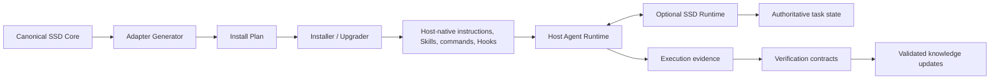
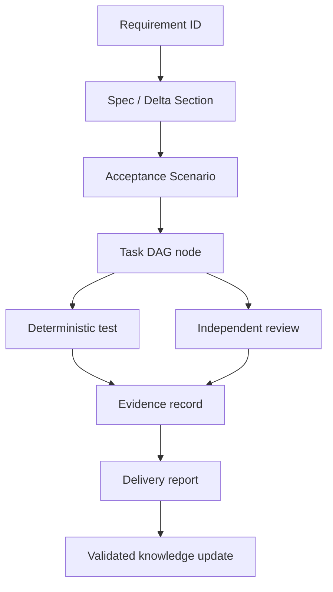
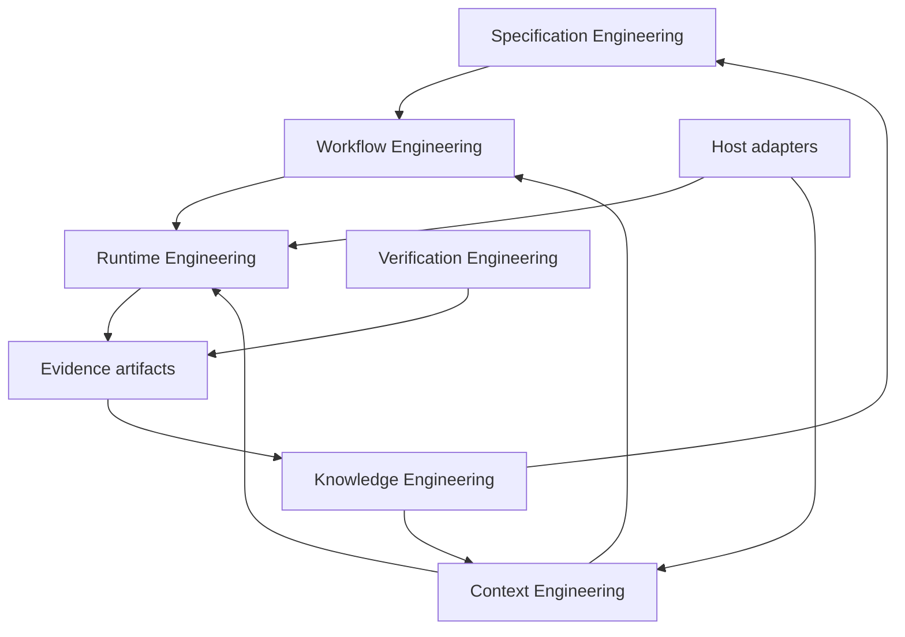

# Spec-Driven Dev Agent Architecture

**Status:** Phase 2 draft; not yet integration-reviewed  
**Research basis:** [`research/comparative-analysis/phase-1-review.md`](research/comparative-analysis/phase-1-review.md)  
**Decision records:** [ADR-001](architecture/adr/ADR-001-portable-core-and-adapters.md), [ADR-002](architecture/adr/ADR-002-authority-and-evidence-boundaries.md), [ADR-003](architecture/adr/ADR-003-host-runtime-boundary.md)

## Product Shape

SSD is a distributable engineering package, not a single prompt or agent role. Its canonical core defines requirements, engineering constraints, artifacts, workflow semantics, context protocols, verification contracts, and knowledge formats. Host adapters translate that core into the native instructions, Skills, agent profiles, commands, Hooks, and settings supported by each AI coding runtime.

The first release should not promise universal compatibility. It should publish a tested adapter matrix and explicitly label capabilities that are guidance-only, host-enforced, or enforced by the optional SSD Runtime.

## Logical Product Layers

| Layer | Responsibility | Authority |
|---|---|---|
| Canonical SSD Core | Host-neutral Constitution, Specs, workflow definitions, Skills, context/runtime contracts, schemas, and evaluation cases | Normative design and behavior contracts |
| Host Adapter | Projects canonical definitions into one host's instruction, Skill, command, Hook, agent, and permission surfaces | Declares tested host-specific capability mappings; does not redefine core semantics |
| Installer / Upgrader | Discovers host, plans file operations, preserves user-owned changes, applies/rolls back, records installed version and ownership | Install manifest and operation receipt |
| SSD Runtime | Validates task state transitions, checkpoints, approvals, tool policy, and execution evidence where a host cannot guarantee them | `execution/state.json` plus append-only/structured event evidence |
| Host Agent Runtime | Executes model calls, tools, agent loops, sandboxes, and native hooks | Host-owned execution behavior; SSD records evidence, not assumed internals |



The host remains the model/tool execution environment. SSD owns portable contracts and may provide a small deterministic companion Runtime; it does not need to recreate every vendor's agent server, sandbox, or orchestration engine.

## Provisional Package Shape

```text
spec-driven-dev-agent/
  core/
    constitution/
    specifications/
    workflows/
    skills/
    context/
    knowledge/
    schemas/
    verification/
  adapters/
    vscode-copilot/
    claude-code/
    codex/
  installer/
  runtime/
    contracts/
    cli/
  evaluation/
  examples/
  research/
```

This is a Phase 2 proposal, not a finalized directory API. Adapter folders are generated projections where practical; hand-authored canonical content remains under `core/`. Add a host folder only when it has a declared contract and conformance evidence.

## Six Engineering Systems

| System | Owns | Must not own |
|---|---|---|
| Specification Engineering | Normative requirements, constraints, acceptance, contracts, and change deltas | Runtime progress or test result claims |
| Context Engineering | Loading policy, manifests, budgets, summaries, and recovery inputs | Authoritative execution state or unsupported facts |
| Workflow Engineering | Lifecycle steps, task DAG semantics, handoffs, and approval points | Deterministic permission enforcement |
| Runtime Engineering | State transitions, scheduling, tool policy, approvals, persistence, and event recording | Product intent or unreviewed specification changes |
| Verification Engineering | Deterministic checks, independent review, conformance, evidence, and quality signals | Self-certifying claims from the implementing agent |
| Knowledge Engineering | Versioned project maps, ADRs, business rules, and derived code intelligence | Ephemeral logs or unverified inferences presented as truth |

## Portable Core and Adapter Boundary

The canonical core uses versioned, host-neutral artifacts. Each adapter declares:

- Discovery and installation locations.
- Supported artifact/Skill/agent/command formats.
- Tool and permission mapping.
- Hook lifecycle events and their exact semantics.
- Subagent/parallel execution support.
- Persistent state and recovery capabilities.
- Installer ownership, upgrade, conflict, and uninstall behavior.
- Conformance status and evidence for each capability.

The installer is responsible for deterministic projection from canonical definitions to host-native files. It must preserve user-owned changes, make updates idempotent, and retain recovery material when rollback cannot complete.

### Adapter Capability Tiers

| Tier | Capability | Guarantee type |
|---|---|---|
| A0: Instructions | Loads persistent instructions and workflow/acceptance artifacts | Model guidance only |
| A1: Skills / Commands | Discovers on-demand Skills or native commands; supports progressive loading | Host invocation plus model guidance |
| A2: Lifecycle Hooks | Exposes tool/session events that can validate, block, or record operations | Host-specific deterministic hooks, subject to host policy/configuration |
| A3: Managed Runtime | Provides durable task state, approval records, recovery, install manifests, and conformance checks | SSD deterministic guarantees for the declared operations |

An adapter reports each capability independently rather than one binary “supported” flag. A tool can support Skills but not blocking Hooks, or Hooks but not persistent task state.

## Authority and Evidence Model

The following separation is proposed; persistence and concurrency details remain open in [ADR-002](architecture/adr/ADR-002-authority-and-evidence-boundaries.md).

| Artifact | Authority role |
|---|---|
| `execution/state.json` | Authoritative state for this SSD project's own phase/task progression; the schema is bootstrap-only until Runtime design |
| `index.md` files | Navigation only; never authoritative status |
| Checkpoints | Resumable snapshots with links to artifacts/evidence; do not replace execution truth |
| Context Manifest | Records why files were loaded for one task; does not assert their contents are current |
| Skills/host instructions | Behavioral guidance; cannot guarantee state, permission, or approval enforcement without host Runtime support |
| Events/logs | Evidence of observed operations; may be incomplete and are not automatically long-term knowledge |
| Tests/review reports | Evidence with scope, command/revision, result, and independence level |

### Core Entities and Traceability

| Entity | Meaning | Required references |
|---|---|---|
| Requirement | Stable behavior or constraint to satisfy | Source request, Spec, acceptance scenario |
| Spec | Versioned normative description of current or proposed behavior | Requirement IDs, decisions, API/data/security constraints |
| Change | One bounded modification to baseline Specs | Changed Spec sections, risk, approval, migration/compatibility notes |
| Task | Executable unit in a dependency graph | Requirement/acceptance IDs, files/modules, verification command |
| Context Manifest | Why specific information was loaded for this task | Task/phase, file+revision, purpose, excluded scope |
| Checkpoint | Resumable snapshot at a verified boundary | State revision, completed work, unresolved risks, evidence references |
| Evidence | Immutable reference to an observed action/result | Command/tool, actor, timestamp, revision, raw result location, pass/fail |
| Knowledge Record | Reusable fact or inference | Provenance, freshness, confidence, epistemic status, invalidation trigger |
| Adapter Capability | Host operation mapped to canonical SSD behavior | Host/version, native surface, semantic mapping, test evidence, limitations |

Traceability chain: `Requirement -> Spec/Delta -> Acceptance Scenario -> Task -> Test/Review Evidence -> Delivery Report`. Missing edges are verification findings, not silently inferred completion.



### Progressive Context Contract

The SSD protocol uses five load tiers, each conditional on the current task:

| Tier | Minimum content | Load condition |
|---|---|---|
| L0 Startup | Agent instructions, project index, authoritative state pointer, hard constraints | Every new or resumed task |
| L1 Phase | Workflow/phase index, phase goal, dependencies, gate, last valid checkpoint | Current phase is selected |
| L2 Task | Task input/output schema, acceptance criteria, mandatory context | Task is selected or resumed |
| L3 Knowledge | Relevant Specs, Skills, ADRs, code ranges, business rules, history | A decision or action requires it |
| L4 Evidence | Raw test output, diff, review, trace, failure record | Verification, dispute, or recovery needs it |

Indexes navigate but do not assert facts. When a loaded artifact is stale or conflicting with the authority source, stop the dependent action and refresh/resolve it.

## End-to-End Flow

```mermaid
flowchart LR
  U[User requirement] --> A[Analyze ambiguity and risk]
  A --> S[Canonical Specification]
  S --> P[Plan and task DAG]
  P --> C[Context Manifest and bounded load]
  C --> W[Workflow orchestration]
  W --> X[Host adapter and coding runtime]
  X --> E[Implementation artifacts and execution evidence]
  E --> V[Deterministic checks and independent review]
  V -->|findings| W
  V -->|accepted evidence| K[Knowledge and spec reconciliation]
  K --> D[Auditable delivery report]
```



## System Collaboration



## Runtime Strategy

The responsibility split below is proposed in [ADR-003](architecture/adr/ADR-003-host-runtime-boundary.md); implementation language/package remains undecided.

Separate the normative workflow from enforcement capability. The MVP may use host-native mechanisms where they are reliable, but must expose a capability tier per host. A local deterministic Runtime is required for guarantees the host cannot provide consistently: authoritative workflow state, state-transition validation, install manifests, human approval records, recovery checks, and conformance verification.

Avoid full event sourcing or multi-agent fan-out by default. Begin with structured state, task DAGs, atomic file operations, checkpoints, and reproducible verification. Adopt event replay, worktree concurrency, or centralized scheduling only when multi-session evidence warrants the complexity.

## Phase 2 Open Decisions

- Candidate MVP hosts: VS Code Copilot, Claude Code, and Codex are evidence-backed candidates, not yet approved scope.
- Canonical Skill format: Agent Skills Open Standard as the interchange surface versus SSD-owned schema with generated projections.
- Runtime packaging: optional local CLI versus host-native scripts plus JSON Schemas.
- Which workflow/permission guarantees are MVP hard constraints versus capability-tier limitations.

## Verification Status

- **Designed:** initial boundaries, authority model, portability hypothesis, and data flow.
- **Not yet validated:** all adapter compatibility claims, schemas, lifecycle transitions, installer conflict behavior, and end-to-end delivery on target hosts.
- **Next:** review this draft, resolve MVP host/Runtime scope, and record accepted tradeoffs in Phase 2 ADRs.